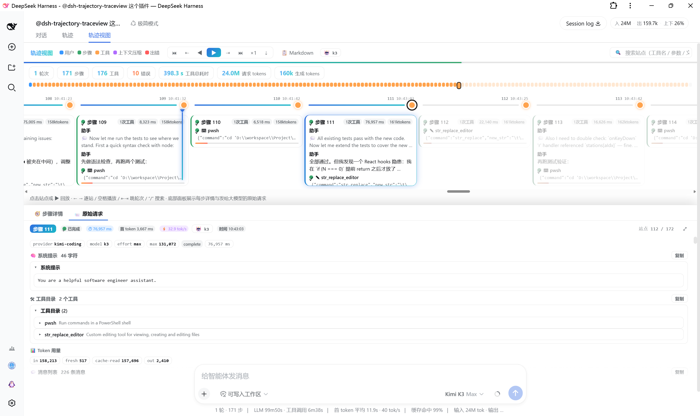

# 轨迹视图 · Trace View

<div align="center">
  <b>中文</b> · <a href="README.en.md">English</a>
</div>

> **把 DeepSeek Harness Web GUI 会话里 AI 的执行过程渲染成一条可回放的横向时间轴——每一步做了什么、每次发给大模型的原始请求都摊开在眼前。**
> 专为「学习与调优提示词」设计：想弄清 AI 为什么这么回答？打开轨迹视图，看它思考了什么、调用了哪些工具、拿到了什么结果，以及它当时真正"看到"的消息载荷。

[](LICENSE)
[](https://github.com/AFAP/dsh-trajectory-traceview/releases)

---

## 1. 它解决了什么问题

长会话里想还原「AI 当时是怎么执行的」，内置轨迹标签只能逐条翻事件列表；想看「某次请求到底把什么发给了大模型」（系统提示、工具目录、重建消息）更是无从下手——这些数据散落在会话内部状态里，没有画面。

本插件在「轨迹」标签右侧新增一个「**轨迹视图**」标签，把同一份会话状态渲染成**可回放、可搜索、可导出的横向时间轴**：

```
会话轨迹（views.get("trajectory") 快照，官方数据完全复用）
  │
  ├─ 顶部 minimap：按时间序的站点色块，点击秒跳
  ├─ 横向时间轴：真实时钟时间标注，◀ ▶ 逐站回放
  ├─ 底部【步骤详情】：思考 / 工具参数 / 结果全文 / 子调用链 / 耗时
  ├─ 底部【原始请求】：该步骤当次发给大模型的完整上下文（提示词学习）
  └─ 头部 KPI：轮次 / 步骤 / 工具 / 错误 / 耗时 / tokens + 📋 一键 Markdown
```

**只读**：只读取会话视图里已生成好的 `TrajectorySnapshot` 快照并重新渲染；不修改任何文件、不访问网络，宿主半部是无操作桩。

## 2. 功能特性

### 流向总览

- ✅ 横向时间轴 + 顶部 **minimap**：每个站点一个色块（用户=蓝 / 步骤=绿 / 工具=橙 / 压缩=紫 / 错误=红 / 重试=黄 / 命令=青），点击色块即跳转，回放时高亮当前站点。
- ✅ 完整事件流：用户消息、助手步骤、工具调用、**上下文压缩**、**轮次失败**、**模型重试**、**输出超限**、**命令**都按时间序上轴；压缩 / 命令事件按 seq 精确归位到所属轮次。
- ✅ KPI 条：轮次 / 步骤 / 工具次数 / 错误数 / 工具总耗时 / 请求与生成 tokens，实时「当前步骤」指示灯 + 当前模型名。
- ✅ 站点轴上标注**真实时钟时间**（不是事件序号）。

### 快速定位

- ✅ 🔍 **搜索**：按工具名 / 参数 / 正文 / 错误名过滤站点，命中站点金色描边 + minimap 高亮；`Enter` / `Shift+Enter` 或 `↑` `↓` 逐个跳转；`/` 或 `f` 聚焦搜索框，`Esc` 清空。
- ✅ **⇤ / ⇥ 轮次跳转**（PageUp / PageDown）：在轮次起点之间跳跃。
- ✅ **⇣ 跟随模式**：AI 正在工作时新站点自动滚入视野；任何手动导航自动暂停跟随，⏭「显示全部」恢复。
- ✅ **检查联动契约**：实现了会话视图的 `inspect` 深链协议——本标签处于活动时若收到工具检查请求，自动定位到包含该调用的站点。
- ✅ **⬆ 加载更早历史**：长会话窗口外的事件一键分页加载（复用会话的 `hasMore` / `loadOlder`）。

### 每一步做了什么（底部「步骤详情」）

- ✅ 助手输出文本与 💭 思考内容（可折叠）。
- ✅ 每个工具调用：参数（格式化 JSON）、**工具结果全文**、**子调用链完整卡片**（子调用自己的参数 / 结果 / 耗时 / 错误）、耗时条、错误码。
- ✅ 步骤级元信息：⏱ 步骤总耗时、首 token 延迟（TTFT）、⚡ 解码吞吐 tok/s、token 用量、「已停止」中断标记。
- ✅ 详情面板可 ⤢ 展开全高 / ⤡ 收起。

### 原始请求（底部「原始请求」标签，快捷键 `r`）

- ✅ **模型配置**：provider / model / temperature / reasoningEffort / thinking / maxTokens / stop / 状态 / 耗时 / 重试信息。
- ✅ **⚡ 提示词变更**：当次请求相对上次的差异摘要——系统提示字符数变化、`+ 新增` / `- 移除` 的工具名（`initial` 为首份系统提示）。
- ✅ **系统提示全文**：字符数 + 一键复制（含工具目录 JSON）。
- ✅ **工具目录**：当次请求携带的全部工具 schema，逐个展开，可一键复制。
- ✅ **消息列表**：按会话日志**近似重建**的 model-visible 消息（用户 / 助手 / 工具结果，含压缩标记），逐条展开全文；可一键复制完整请求载荷 JSON。**仅在打开本标签时才重建**（懒加载，长会话不卡顿）。
- ✅ **Token 用量**：入站（含缓存读 / 写）与出站（含思考）明细。
- ✅ **上下文压缩站点**也有自己的「原始请求」：压缩请求的模型 / 耗时 / usage 与**压缩产出全文**。

### 导出学习笔记

- ✅ 头部 **📋 Markdown**：一键把整段轨迹复制为 Markdown——每步的思考 / 正文 / 工具参数 / 结果、每步请求配置摘要，以及附录「首个请求的系统提示与工具目录」。

## 3. 效果预览

| 轨迹视图总览（时间轴 + minimap + 底部详情 / 原始请求面板） |
|:---:|
|  |

## 4. 目录结构

```
dsh-trajectory-traceview/   # 仓库根 = npm 包根
├── package.json            # dsh.bundle.patch + dsh.client（浏览器端声明）+ exports["./client"]
├── cordis.patch.yml        # 组合行：仅插入一行插件记录（无路由、无配置）
├── LICENSE                 # MIT
├── screenshot/             # 效果截图（README「效果预览」用）
├── test/
│   └── smoke.test.cjs      # 纯 helpers 单测（零依赖，node 直接跑）
└── lib/
    ├── index.js            # 宿主半部：无操作桩（纯浏览器端插件）
    └── client.js           # 浏览器 bundle：轨迹视图（时间轴 / minimap / 详情 / 原始请求）
```

## 5. 快速开始

一键安装（GitHub）：

```powershell
dsh plugin --profile web add github:AFAP/dsh-trajectory-traceview
```

然后**重启 `dsh web`** 生效。

> 安装后插件位于 `$DSH_HOME\profiles\web\node_modules\dsh-trajectory-traceview`（pnpm 从 GitHub 克隆），与源码仓库位置无关。

升级：

```powershell
dsh plugin --profile web update dsh-trajectory-traceview
```

卸载：

```powershell
dsh plugin --profile web remove dsh-trajectory-traceview
```

### 从源码目录手动安装（等价验证用）

```powershell
dsh plugin --profile web add "G:\path\to\dsh-trajectory-traceview"
```

### 验证是否加载成功

打开任意有 AI 执行轨迹的会话 → 会话顶部「轨迹」标签旁出现「轨迹视图」标签 → 点击后能看到横向时间轴与 minimap，即加载成功。

## 6. 使用

1. 打开任意会话（有 AI 执行轨迹即可）。
2. 点击「轨迹视图」标签：顶部 minimap 是全部站点缩略图，下方时间轴按真实时钟时间排列。
3. **浏览 / 回放**：◀ ▶ 或键盘逐站浏览；▶ 自动回放（×1 / ×2 / ×4 三档速度）；空格 播放 / 暂停。
4. **搜索**：按 `/` 聚焦搜索框，输入工具名 / 参数 / 正文 / 错误名，Enter 逐个跳转命中站点。
5. **选中任意助手步骤**：底部「步骤详情」展示思考、正文与每个工具调用的参数 / 结果 / 子调用 / 耗时；点「原始请求」标签（或按 `r`）查看当次发给大模型的完整上下文，用于提示词学习。
6. **导出笔记**：点头部 📋 把整段轨迹复制为 Markdown。
7. **长会话**：点 ⬆ 加载更早历史；AI 正在工作时开 ⇣ 跟随模式自动跟进。

## 7. 快捷键

| 按键 | 功能 |
|---|---|
| `←` / `→` | 上一个 / 下一个站点 |
| `Home` / `End` | 跳到开头 / 结尾 |
| `空格` | 播放 / 暂停回放 |
| `PageUp` / `PageDown` | 上一个 / 下一个轮次起点 |
| `/` 或 `f` | 聚焦搜索框 |
| `↑` / `↓`（搜索时） | 上一个 / 下一个搜索命中 |
| `Enter` / `Shift+Enter`（搜索时） | 下一个 / 上一个命中 |
| `Esc` | 清空搜索 / 取消 |
| `r` | 切换「原始请求」面板 |

## 8. 实现要点（数据来源）

| 关注点 | 做法 |
|---|---|
| 数据来源 | 完全复用 DSH Web 会话状态里的 `views.get("trajectory")` 快照（`TrajectorySnapshot`）：`eventNodes`（含 `timing` / `usage` / `provenance` / `interrupted`）、`requests`（助手请求 + 压缩请求）、`callSchemas`（调用时刻的工具 schema）、`partial` / `runningCalls`（流式实时态），以及会话级 `hasMore` / `loadOlder` 历史分页。 |
| 原始请求 | 「消息列表」是按会话日志**近似重建**的载荷（原始 messages 数组不落快照），面板内已注明"近似"，用于提示词学习足够精确。 |
| 懒加载 | 消息列表仅在打开「原始请求」标签时才重建，长会话不卡顿。 |
| 挂载方式 | 通过 `dsh.client.inject`（`dsh-client-runtime` / `dsh-client-locale` / `dsh-client-ui-conversation`）在会话视图「轨迹」标签旁注册新标签。 |
| 检查联动 | 实现会话视图的 `inspect` 深链协议：收到工具检查请求时自动定位到包含该调用的站点。 |

## 9. 日志与排错

| 现象 | 排查方向 |
|---|---|
| 看不到「轨迹视图」标签 | 确认已重启 `dsh web`；F12 Console 搜 `dsh-trajectory-traceview`。 |
| 时间轴空白 / 无站点 | 会话需要已有 AI 执行轨迹（用户消息 → 助手步骤）；新会话无数据时面板显示空态提示。 |
| 搜索无命中 | 检查搜索词是否匹配 工具名 / 参数 / 正文 / 错误名。 |
| 消息列表与实际请求不符 | 「消息列表」是近似重建（原始 messages 不落快照），面板内已注明；以系统提示与工具目录为准。 |
| 打开较旧会话缓慢 | 只有打开「原始请求」标签才重建消息列表；正常浏览时间轴不受影响。 |

## 10. 安全与合规

- **只读**：只读取会话视图已生成的 `TrajectorySnapshot` 快照并渲染；不修改 DOM 业务结构、不修改 / 删除任何文件、无宿主路由、不访问网络。
- **本地数据**：所有数据均在浏览器内处理；原始请求只在主动打开面板时才重建，不写入任何存储。
- **无持久化**：不写 localStorage / cookie；卸载即无痕。

## 11. 开发与自测

纯 JS 无构建步骤。`lib/index.js`（宿主半部）是无操作桩；`lib/client.js` 是经典脚本（`window.__ModuleLoader__.load`），由客户端模块系统直接服务。

```powershell
node test/smoke.test.cjs
```

自测用 mock 快照覆盖：树构建 / 请求附加 / 压缩请求配对 / 子调用详情 / prompt diff / 步骤计时 / 搜索匹配 / Markdown 导出 / token 统计。

## 12. License

MIT © AFAP

---

> **免责声明**：本插件为本地学习 / 调试工具，不对任何因使用轨迹数据（含近似重建的消息载荷）做出的决策负责；请勿在共享 / 多人环境展示含敏感内容的会话轨迹。